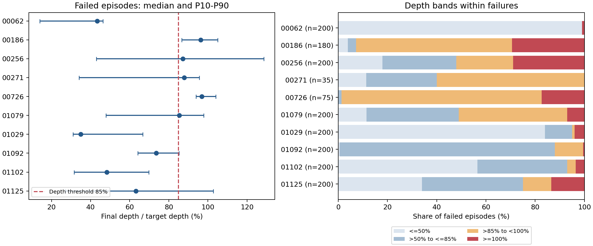

# AutoMate 十任务专家训练结果与新版 relaxed 计算依据

整理日期：2026-10-10。实验为 2026-09-25 启动的十任务专家队列，冻结配对评估于 2026-09-27 完成。十个专家均完成训练，官方宏平均为 **76.85%**，完整新版 relaxed 宏平均为 **15.50%**，其中七任务为 0/200。

## 方法和评估协议

目录名称含 `srsa`，实际方法为 **AutoMate scratch specialists**：十任务各自从零训练 PPO，dense SDF、轨迹模仿奖励和 SBC，采用 `physical_grasp`。未使用 SRSA 技能库检索、源策略迁移初始化或 SIL；十个专家不是一个共享 generalist。

每任务训练 seed=1、250 env、1500 PPO iterations、12,000,000 transitions，总计 120,000,000。actor 为 24D 观测、6D 动作。各任务固定最终 epoch 1500 checkpoint，不按已经看到的测试分数选 best。评估为 deterministic mean action、关闭评估 SBC，seed 5101/5102 各 100 完整回合；两个评估 seed 不构成两个训练重复。

## 完整新版 relaxed 在哪里计算

计算分为三步：**每个控制步判断条件并更新连续计数，终止时写入 HDF5，最后逐任务求成功数和比例**。下面十任务的新版值读取的是已在闭环评估中计算好的 `relaxed_success_stable`，不是用末步深度重新猜测成功。

| 阶段 | 代码入口 | 计算或输出 |
|---|---|---|
| 深度及横向误差 | [assembly_runtime_env.py](../source/SRSA/SRSA/tasks/direct/srsa/assembly_runtime_env.py:2112) | plug 相对 socket 的局部位置、目标深度、depth_fraction 和 lateral_error |
| 新版逐步条件与连续计数 | [relaxed_eval.py](../source/SRSA/SRSA/tasks/direct/srsa/relaxed_eval.py:6) | 深度严格 >0.85、横向合格、no-jam；通过则 streak+1，否则清零；streak≥3 时 stable=true |
| 闭环每步调用 | [assembly_direct_env.py](../source/SRSA/SRSA/tasks/direct/srsa/assembly_direct_env.py:41) | `_get_rewards()` 调用 `relaxed_step`；SRSA 此入口用环境变量 `SRSA_RELAXED_DEPTH_UNBOUNDED=1` 启用 |
| 终态记录 | [assembly_direct_env.py](../source/SRSA/SRSA/tasks/direct/srsa/assembly_direct_env.py:57) | episode 结束时保存该步 stable；写入 HDF5 的 `relaxed_success_stable` |
| 按任务和 seed 汇总 | [analyze_success_definitions.py](../scripts/automate/analyze_success_definitions.py:61) | 读取每任务两个 HDF5，分别求和，再合并为 200 回合 |
| 三口径逐任务成功计数 | [analyze_success_definitions.py](../scripts/automate/analyze_success_definitions.py:97) | `modified_relaxed = sum(relaxed_success_stable)`；报告成功数/200 |

FACA TD-MPC2 入口使用配置 `relaxed_depth_unbounded=true`；本批 SRSA/AutoMate 评估实现同样的单侧深度规则，但启用开关是上表中的环境变量。两种启动方式不能混写。

令 socket 局部相对位置为 r、目标插入深度为 D：

```text
depth_fraction = max(0, D - r_z) / max(D, 1e-6)
lateral_error = norm(r_xy)
lateral_tol = clamp(2 * radial_clearance, 0.001, 0.003)  # 米
jam = contact AND NOT current_official
      AND lateral_error > max(radial_clearance, lateral_tol)
process = depth_fraction > 0.85 AND lateral_error <= lateral_tol AND NOT jam
streak = streak + 1 if process else 0
stable = process AND streak >= 3
```

终止控制步的 `stable` 才是该回合主成功值。`relaxed_success_episode` 是回合内曾稳定成功的锁存量，不能替代它；`relaxed_depth_fraction_final` 只是末态深度诊断。姿态、yaw、keypoint 不进入这里的 relaxed gate。no-jam 使用上述已有诊断定义，不能解释为独立验证过的机械卡死标签。

## 十任务三种成功率

官方成功是回合内曾命中的锁存量；原版 relaxed 保留 `[0.85, 1)` 深度窗口；新版 relaxed 深度严格 `>0.85` 且无上限，其余横向、no-jam、连续三步要求保留。两个 relaxed 在同一 rollout 中维护各自独立 streak。

| 任务 | 官方 | 原版 relaxed | 完整新版 relaxed | seed 5101 | seed 5102 | 新版合计 |
|---|---:|---:|---:|---:|---:|---:|
| 00062 | 46.0% | 0.0% | 0.0% | 0/100 | 0/100 | 0/200 |
| 00186 | 96.5% | 6.5% | 10.0% | 8/100 | 12/100 | 20/200 |
| 00256 | 64.0% | 0.0% | 0.0% | 0/100 | 0/100 | 0/200 |
| 00271 | 98.0% | 82.5% | 82.5% | 83/100 | 82/100 | 165/200 |
| 00726 | 97.0% | 49.0% | 62.5% | 62/100 | 63/100 | 125/200 |
| 01079 | 87.5% | 0.0% | 0.0% | 0/100 | 0/100 | 0/200 |
| 01029 | 0.0% | 0.0% | 0.0% | 0/100 | 0/100 | 0/200 |
| 01092 | 97.0% | 0.0% | 0.0% | 0/100 | 0/100 | 0/200 |
| 01102 | 92.5% | 0.0% | 0.0% | 0/100 | 0/100 | 0/200 |
| 01125 | 90.0% | 0.0% | 0.0% | 0/100 | 0/100 | 0/200 |
| **十任务平均或总计** | **76.85%** | **13.80%** | **15.50%** | **153/1,000** | **157/1,000** | **310/2,000** |

例如 00271：`(83 + 82) / (100 + 100) = 82.5%`；00726：`(62 + 63) / 200 = 62.5%`；00186：`(8 + 12) / 200 = 10.0%`。十任务每任务等权，宏平均为 `sum(各任务成功率)/10`；本批每任务样本数相同，所以也等于 `310/2,000 = 15.50%`。

## 每个任务的数据文件位置

以下 HDF5 均在 `logs/rl_games/Assembly/faca00271_automate_paired_relaxed_eval_20260927/`。每个文件的 `relaxed_success_stable` 为 100×1 的逐回合布尔/0–1 数组；对其求和得到上一表的对应 seed 成功数。

| 任务 | seed 5101 HDF5 | seed 5102 HDF5 |
|---|---|---|
| 00062 | [00062_seed5101.h5](../logs/rl_games/Assembly/faca00271_automate_paired_relaxed_eval_20260927/00062_seed5101.h5) | [00062_seed5102.h5](../logs/rl_games/Assembly/faca00271_automate_paired_relaxed_eval_20260927/00062_seed5102.h5) |
| 00186 | [00186_seed5101.h5](../logs/rl_games/Assembly/faca00271_automate_paired_relaxed_eval_20260927/00186_seed5101.h5) | [00186_seed5102.h5](../logs/rl_games/Assembly/faca00271_automate_paired_relaxed_eval_20260927/00186_seed5102.h5) |
| 00256 | [00256_seed5101.h5](../logs/rl_games/Assembly/faca00271_automate_paired_relaxed_eval_20260927/00256_seed5101.h5) | [00256_seed5102.h5](../logs/rl_games/Assembly/faca00271_automate_paired_relaxed_eval_20260927/00256_seed5102.h5) |
| 00271 | [00271_seed5101.h5](../logs/rl_games/Assembly/faca00271_automate_paired_relaxed_eval_20260927/00271_seed5101.h5) | [00271_seed5102.h5](../logs/rl_games/Assembly/faca00271_automate_paired_relaxed_eval_20260927/00271_seed5102.h5) |
| 00726 | [00726_seed5101.h5](../logs/rl_games/Assembly/faca00271_automate_paired_relaxed_eval_20260927/00726_seed5101.h5) | [00726_seed5102.h5](../logs/rl_games/Assembly/faca00271_automate_paired_relaxed_eval_20260927/00726_seed5102.h5) |
| 01079 | [01079_seed5101.h5](../logs/rl_games/Assembly/faca00271_automate_paired_relaxed_eval_20260927/01079_seed5101.h5) | [01079_seed5102.h5](../logs/rl_games/Assembly/faca00271_automate_paired_relaxed_eval_20260927/01079_seed5102.h5) |
| 01029 | [01029_seed5101.h5](../logs/rl_games/Assembly/faca00271_automate_paired_relaxed_eval_20260927/01029_seed5101.h5) | [01029_seed5102.h5](../logs/rl_games/Assembly/faca00271_automate_paired_relaxed_eval_20260927/01029_seed5102.h5) |
| 01092 | [01092_seed5101.h5](../logs/rl_games/Assembly/faca00271_automate_paired_relaxed_eval_20260927/01092_seed5101.h5) | [01092_seed5102.h5](../logs/rl_games/Assembly/faca00271_automate_paired_relaxed_eval_20260927/01092_seed5102.h5) |
| 01102 | [01102_seed5101.h5](../logs/rl_games/Assembly/faca00271_automate_paired_relaxed_eval_20260927/01102_seed5101.h5) | [01102_seed5102.h5](../logs/rl_games/Assembly/faca00271_automate_paired_relaxed_eval_20260927/01102_seed5102.h5) |
| 01125 | [01125_seed5101.h5](../logs/rl_games/Assembly/faca00271_automate_paired_relaxed_eval_20260927/01125_seed5101.h5) | [01125_seed5102.h5](../logs/rl_games/Assembly/faca00271_automate_paired_relaxed_eval_20260927/01125_seed5102.h5) |

[评估 manifest](../logs/rl_games/Assembly/faca00271_automate_paired_relaxed_eval_20260927/manifest.json) 保存任务、seed、checkpoint 和哈希；[result.json](../logs/rl_games/Assembly/faca00271_automate_paired_relaxed_eval_20260927/result.json) 保存逐评估作业状态和输出位置。本次重新核对全部 20 文件的数组长度、0–1 值、seed、checkpoint 哈希和逐任务成功数，另存 [逐任务计数与文件 SHA256 CSV](pre_automate_results_20261010/automate10_recheck/relaxed_per_task_sources.csv)。

## 失败回合的 final progress 详细统计

失败按完整新版 `relaxed_success_stable=0` 筛选，共 **1,690/2,000 回合**。final progress 为 `relaxed_depth_fraction_final`：末态插入深度/目标深度；下表以百分比展示，保留超过 100% 的值，不裁剪。不是回合最大深度，也不是毫米深度。

### 逐任务失败深度分布

均值、中位数和分位数仅在该任务失败回合内计算；标准差为样本标准差，分位数采用线性插值。

| 任务 | 失败数 | 均值 | 标准差 pp | 最小 | P10 | P25 | 中位数 | P75 | P90 | 最大 |
|---|---:|---:|---:|---:|---:|---:|---:|---:|---:|---:|
| 00062 | 200 | 38.73 | 30.09 | 0.00 | 14.08 | 31.15 | 43.32 | 45.59 | 46.26 | 377.68 |
| 00186 | 180 | 93.68 | 15.38 | 0.00 | 86.58 | 90.83 | 96.33 | 100.70 | 104.95 | 119.49 |
| 00256 | 200 | 100.47 | 139.98 | 9.68 | 42.95 | 55.68 | 87.22 | 103.12 | 128.53 | 1223.77 |
| 00271 | 35 | 79.08 | 28.18 | 0.00 | 34.08 | 80.83 | 87.85 | 94.50 | 95.55 | 96.27 |
| 00726 | 75 | 104.76 | 57.72 | 64.13 | 93.94 | 94.75 | 96.80 | 99.34 | 104.09 | 593.04 |
| 01079 | 200 | 83.52 | 57.57 | 0.00 | 47.82 | 76.39 | 85.39 | 92.77 | 97.80 | 835.15 |
| 01029 | 200 | 51.32 | 82.21 | 0.00 | 31.03 | 33.48 | 34.92 | 37.98 | 66.61 | 743.01 |
| 01092 | 200 | 74.37 | 9.21 | 43.40 | 64.09 | 68.19 | 73.57 | 79.83 | 85.27 | 123.23 |
| 01102 | 200 | 56.76 | 55.63 | 0.00 | 31.61 | 39.43 | 48.23 | 58.86 | 69.77 | 509.25 |
| 01125 | 200 | 94.85 | 147.23 | 0.00 | 27.02 | 45.32 | 63.17 | 84.25 | 102.69 | 871.99 |
| 全部失败回合 | 1690 | 75.44 | 84.78 | 0.00 | 32.31 | 43.65 | 68.23 | 91.61 | 100.93 | 1223.77 |

全部失败回合一行按回合合并，失败多的任务权重较高，不能当作十任务等权宏平均。深度比例为坐标计算量，超过 100% 不足以单独证明物理穿透或正确就位。

### 失败深度区间计数

每格为计数及占该行失败回合比例；四区间互斥且穷尽，恰好 85% 属于不达标。

| 任务 | ≤50% | >50% 且 ≤85% | >85% 且 <100% | ≥100% |
|---|---:|---:|---:|---:|
| 00062 | 198 (99.0%) | 0 (0.0%) | 0 (0.0%) | 2 (1.0%) |
| 00186 | 7 (3.9%) | 6 (3.3%) | 114 (63.3%) | 53 (29.4%) |
| 00256 | 36 (18.0%) | 60 (30.0%) | 46 (23.0%) | 58 (29.0%) |
| 00271 | 4 (11.4%) | 10 (28.6%) | 21 (60.0%) | 0 (0.0%) |
| 00726 | 0 (0.0%) | 1 (1.3%) | 61 (81.3%) | 13 (17.3%) |
| 01079 | 23 (11.5%) | 75 (37.5%) | 88 (44.0%) | 14 (7.0%) |
| 01029 | 168 (84.0%) | 22 (11.0%) | 2 (1.0%) | 8 (4.0%) |
| 01092 | 1 (0.5%) | 175 (87.5%) | 23 (11.5%) | 1 (0.5%) |
| 01102 | 113 (56.5%) | 73 (36.5%) | 7 (3.5%) | 7 (3.5%) |
| 01125 | 68 (34.0%) | 82 (41.0%) | 23 (11.5%) | 27 (13.5%) |
| 全部失败回合 | 618 (36.6%) | 504 (29.8%) | 385 (22.8%) | 183 (10.8%) |

### 终态失败条件分解

按顺序分类：深度≤85%；深度>85%但横向不合格；深度和横向均合格但 jam；末步条件全部合格却未满足终态连续三步。类别互斥且穷尽，是末态条件分解，不是故障根因。末步条件全合格但 stable=0 的分类直接使用已保存的 stable 值，不重建缺失轨迹。

| 任务 | 深度不达标 | 达深度但横向失败 | 深度横向合格但 jam | 末步合格但稳定不足 | 失败横向中位数 mm |
|---|---:|---:|---:|---:|---:|---:|
| 00062 | 198 | 2 | 0 | 0 | 2.55 |
| 00186 | 13 | 166 | 0 | 1 | 1.60 |
| 00256 | 96 | 104 | 0 | 0 | 10.14 |
| 00271 | 14 | 21 | 0 | 0 | 1.30 |
| 00726 | 1 | 72 | 0 | 2 | 2.45 |
| 01079 | 98 | 102 | 0 | 0 | 11.07 |
| 01029 | 190 | 10 | 0 | 0 | 21.58 |
| 01092 | 176 | 24 | 0 | 0 | 12.00 |
| 01102 | 186 | 14 | 0 | 0 | 9.60 |
| 01125 | 150 | 50 | 0 | 0 | 9.97 |
| 全部失败回合 | 1122 | 565 | 0 | 3 | 10.21 |

jam 与横向失败可以同时出现。先分横向的表不重复计 jam；所以 jam 列为零不表示原始 jam 标志全为零。所有失败回合的原始 jam 总数另存 JSON。

### 评估 seed 和曾经成功对照

各 seed 单独对失败回合求深度均值/中位数，单位为目标深度百分比。两 seed 是同一训练模型的评估重复。曾稳定成功指 `relaxed_success_episode=1` 但终态 stable=0；官方曾成功使用独立官方锁存标签。

| 任务 | 5101 失败数 | 5101 均值/中位数 | 5102 失败数 | 5102 均值/中位数 | 失败中曾稳定成功 | 失败中官方曾成功 |
|---|---:|---:|---:|---:|---:|---:|
| 00062 | 100 | 40.42/43.18 | 100 | 37.05/43.86 | 0 | 92 |
| 00186 | 92 | 94.89/97.28 | 88 | 92.43/95.39 | 28 | 173 |
| 00256 | 100 | 95.37/87.77 | 100 | 105.58/86.96 | 0 | 128 |
| 00271 | 17 | 82.71/87.18 | 18 | 75.64/89.94 | 6 | 31 |
| 00726 | 38 | 99.00/97.49 | 37 | 110.67/95.92 | 1 | 70 |
| 01079 | 100 | 81.35/86.86 | 100 | 85.69/84.22 | 0 | 175 |
| 01029 | 100 | 46.38/34.95 | 100 | 56.26/34.89 | 0 | 0 |
| 01092 | 100 | 74.05/72.95 | 100 | 74.68/74.42 | 0 | 194 |
| 01102 | 100 | 51.18/46.79 | 100 | 62.34/48.48 | 0 | 185 |
| 01125 | 100 | 86.38/62.12 | 100 | 103.32/64.58 | 0 | 180 |

成功回合、全部回合与失败回合的独立深度统计，以及逐 seed 的完整分位数，均保存在 `summary.json`；没有成功样本的任务用 null 表示成功深度统计，不能填 0。

### 极端深度值及解读

失败回合中有 **27 个**末态深度比例严格超过 200%。这是用于检查长尾的描述性阈值，不是成功或安全门槛。原始值不删除、不截断；全部明细见 `failed_depth_gt_200pct.csv`。

00186、00271、00726 的失败深度中位数均超过 85%，但仍可能横向不合格或终态稳定不足。01125 的失败均值接近 95%，中位数只有约 63%，说明均值被极端尾部拉高；不能把高均值解读为普遍接近完成。

| 任务 | seed | HDF5 行索引从 0 起 | final progress % | 横向误差 mm |
|---|---:|---:|---:|---:|
| 00256 | 5102 | 68 | 1223.77 | 159.54 |
| 00256 | 5102 | 8 | 1176.08 | 380.26 |
| 00256 | 5101 | 81 | 1134.27 | 120.62 |
| 01125 | 5102 | 47 | 871.99 | 21.73 |
| 01125 | 5102 | 8 | 867.64 | 108.16 |
| 01125 | 5101 | 35 | 863.01 | 30.73 |
| 01125 | 5102 | 22 | 845.58 | 34.71 |
| 01079 | 5102 | 70 | 835.15 | 136.29 |
| 01125 | 5102 | 56 | 822.38 | 33.95 |
| 01029 | 5102 | 59 | 743.01 | 281.89 |

上表列最大十个异常值。由 plug/socket 根位姿计算的深度可能因离轴、物体位置异常等产生大值；仅凭这些末态记录不能确定原因，也不能把 >100% 等同于实际正确插入或碰撞穿透。

### 统计图和可复核明细



左图为失败回合中位数和 P10–P90，未展示区间外极值；右图为各任务失败深度区间占比。极值完整保留在前表和 CSV 中。

- [逐回合数据 CSV](pre_automate_results_20261010/automate10_failed_final_progress/episodes.csv)：全部 2,000 行，含成功/失败、末态深度、横向、jam、曾稳定成功、失败分类、源文件和行索引。
- [逐任务及逐 seed 统计 CSV](pre_automate_results_20261010/automate10_failed_final_progress/task_and_seed_statistics.csv)。
- [完整 JSON 和源文件 SHA256](pre_automate_results_20261010/automate10_failed_final_progress/summary.json)。
- [超过 200% 的失败回合明细](pre_automate_results_20261010/automate10_failed_final_progress/failed_depth_gt_200pct.csv)。
- [可导出 SVG 图](pre_automate_results_20261010/automate10_failed_final_progress/failed_final_progress.svg)。
- [统计脚本](../scripts/automate/analyze_failed_final_progress.py)。

复算命令：

```bash
/home/gpuserver/miniconda3/envs/isaac51/bin/python \
  scripts/automate/analyze_failed_final_progress.py \
  --paired logs/rl_games/Assembly/faca00271_automate_paired_relaxed_eval_20260927 \
  --output docs/pre_automate_results_20261010/automate10_failed_final_progress
```

这些统计只描述给定冻结模型的末态记录；没有新增训练或仿真。27 个超过 200% 的失败深度值未经原因确诊，不能以删除它们后的均值替换原始统计。

## 结果解释

新版 relaxed 比原版多 34 个成功回合，宏平均增加 1.70 pp；00186 增加 7 个，00726 增加 27 个。移除深度上限没有解决多数专家的终态质量问题。00271 为 82.5%，00726 为 62.5%，00186 为 10%，其余七任务为 0%。

00256 和 01079 的终态横向合格均为 0/200；01092、01102、01125 的官方高成功率不能代替终态稳定插入。现有专家训练完成，但不能据此称十任务 BC/DAgger 或共享策略已完成。一个训练 seed 的结果也不足以宣称跨训练随机性稳定。

FACA 9 月 24 日的 M3 96.30% 只按末态深度重算，和这里的完整新版 relaxed 15.50% 不同；任务集、动作与训练成本也不同，不应直接相减为方法收益。

## 复算命令和汇总文件

在 SRSA 仓库根目录执行：

```bash
/home/gpuserver/miniconda3/envs/isaac51/bin/python \
  scripts/automate/analyze_success_definitions.py \
  --paired logs/rl_games/Assembly/faca00271_automate_paired_relaxed_eval_20260927 \
  --output docs/pre_automate_results_20261010/automate10_recheck
```

[comparison.json](pre_automate_results_20261010/automate10_recheck/comparison.json) 的 `tasks[].modified_relaxed` 是逐任务成功整数数，`by_seed[].modified_relaxed` 是分 seed 成功数，`overall.modified_relaxed=310`。各任务比例需要用整数数除以对应回合数，字段本身不是百分比。该复算只聚合已保存的闭环成功量，不重新执行仿真，也不能从末态文件重建最后三步轨迹。

原始训练来源：[队列 manifest](../logs/rl_games/Assembly/faca00271_srsa_queue_20260925_113344_250env_numba1/manifest.json)、[队列 status](../logs/rl_games/Assembly/faca00271_srsa_queue_20260925_113344_250env_numba1/status.json)、[teacher_bank.json](../runs/automate10/dagger_prepare_20260927/teacher_bank.json)。历史文件保留；本次未改变训练代码、checkpoint 或成功定义。
